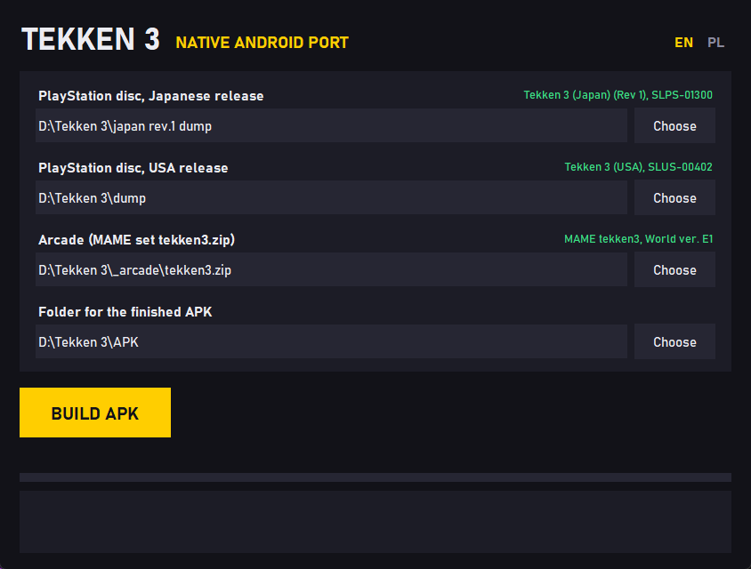

### t3native

A native Android (C++ NDK) port of [n0madic/Tekken3Remake](https://github.com/n0madic/Tekken3Remake),
translated file for file from its GDScript `remake/core` and proven bit-exact by the same golden
traces the remake is tested with (the original game's code run in a MIPS + GTE CPU harness).

Derived from Tekken3Remake, licensed under the PolyForm Noncommercial License 1.0.0
(see `LICENSE.md`, copied from the source project). Noncommercial use only.

No game data is included. Assets come from your own disc through the remake's converter
(`tools/remake_import/convert.py`) into `remake/imported/`; traces from
`tools/research/export_traces.py` and `flow_trace.py` into `work/traces/`.

### Builder



`Tekken3Builder.exe` (in the releases) makes the APK from your own discs: one file, nothing to
install, no game data inside. Choose the Japanese PlayStation disc (Tekken 3 (Japan) (Rev 1) or
(Japan), SLPS-01300), optionally the USA disc (SLUS-00402, English texts) and MAME's arcade set
`tekken3` (World ver. E1), and click BUILD APK. The window checks every choice and names the
release it found. NETWORK MODE in the APK finds games through the router and over Wi-Fi Direct
(no router) at once. The first build makes a signing key next to the .exe; later builds reuse it, so a new APK
installs over the old one. Sources: `builder/`, `tools/make_builder.py`; see `builder/README.txt`.

### Layout

| Path | Source |
|---|---|
| `src/gd/` | GDScript value model (int64, shared packed arrays, Array, Dictionary), JSON, gzip |
| `src/core/` | `remake/core/` |
| `src/content/` | `remake/content/` |
| `src/platform/` | `remake/platform/` |
| `tests/` | `remake/tests/` (trace suites) |

### Build and test

Host (MinGW g++ 15, CMake, Ninja):

```bash
cmake -S . -B build/host -G Ninja -DCMAKE_CXX_COMPILER=g++
cmake --build build/host
build/host/t3tests --imported <remake/imported> --traces <work/traces> [filter]
```

Android arm64-v8a (NDK r26):

```bash
cmake -S . -B build/arm64 -G Ninja -DCMAKE_TOOLCHAIN_FILE=<ndk>/build/cmake/android.toolchain.cmake -DANDROID_ABI=arm64-v8a -DANDROID_PLATFORM=android-26
cmake --build build/arm64
```
